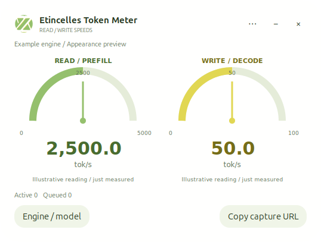

# Etincelles Token Meter

A rounded, borderless desktop bubble in the official **Etincelles green, white and gold** palette, with **Read / prefill** and **Write / decode** speedometers and numeric tok/s readouts. Includes the supplied Etincelles logo, custom window controls, optional always-on-top, start at login, and a user-level uninstaller. Choose an engine endpoint and model; use the same widget with different models.

The repository was created as AI-token-meter. The application's name is **Etincelles Token Meter**.

*Appearance preview with illustrative readings; these numbers are not a benchmark.*

## Official Etincelles appearance

The palette is sampled from the supplied logo: green **#95C06D**, warm white **#FFFFFE**, and gold **#E1D753**. Darker green and gold text keeps the numbers readable on white. The original logo PNGs are included unchanged.

Drag the logo or header to move the bubble. The custom header provides **Options (three dots)**, **Minimize**, and **Close**. There is no operating-system title bar around the main widget. Settings and confirmation dialogs open separately. Windows uses a native rounded window region; Linux uses an undecorated GTK window and rounded window shape.

See [branding details](docs/BRANDING.md).

## Compatibility

| Engine / interface | Connection | Timing and update behavior |
| --- | --- | --- |
| vLLM | Poll its existing /metrics endpoint | Uncached prefill time; live engine-timed decode when counters are available; completed-request fallback |
| llama.cpp server | Poll /metrics with server metrics enabled | Native prompt/decode time deltas; server-run average on first connection |
| Ollama | Send /api/chat or /api/generate requests through this widget's local capture proxy | Native final-response timing; updates when each request finishes |
| Engines returning llama.cpp timings | Capture proxy | Engine-reported prompt and predicted rates |
| Custom engine | Capture proxy with the documented timing hook | Native measured phase durations supplied by the engine |
| OpenAI-compatible API with usage counts only | Capture proxy can forward requests | Native timing **unavailable**; counts alone cannot produce phase speed |

Model independence does not mean every engine exposes timing. No GPU-specific library, model download, cloud account or API subscription is required by the widget. An inference engine must already be running. Engine metric names and response extensions vary by version.

See [measurement details](docs/MEASUREMENTS.md) and [validation](docs/VALIDATION.md) for tested scope. This is not a benchmark ranking between GPUs.

## Windows

Download a Windows executable from [Releases](https://github.com/Etincelles-Inc/AI-token-meter/releases), when available, or build it using the script below.

1. Open EtincellesTokenMeter.exe.
2. Choose **Engine / model**. For Ollama use engine ollama and base URL http://127.0.0.1:11434. For vLLM use its server URL, commonly http://127.0.0.1:8000.
3. With vLLM or llama.cpp metrics, readings arrive without changing application requests.
4. With Ollama, click **Copy capture URL** and use that URL in the application's Ollama connection. The default is http://127.0.0.1:18630. Keep the widget open while using this URL.

The capture URL is the base URL: retain /api/chat, /api/generate or the appropriate API path used by the client. Requests sent directly to Ollama do not pass through the widget and cannot be measured by it. Ollama's OpenAI compatibility endpoint may omit native timings; use its native /api endpoints for readings.

For shortcuts, choose **Options > Install for this user**, then open the installed shortcut. Installation requires no administrator rights. Start at login is optional.

To remove it, choose **Options > Uninstall**, the **Uninstall Etincelles Token Meter** Start menu shortcut, or run the executable with --uninstall --yes. Close other instances first. Change clients back to the engine's original base URL before removing or closing a capture proxy they use.

## Python source / Linux

Python 3.10+ and a desktop GUI are required. The runtime uses Python's standard library. Windows Python normally includes Tk. Linux needs either Tkinter, or GTK 3 with PyGObject and Cairo; the widget automatically falls back to GTK when Tkinter is absent. For example, Ubuntu packages python3-tk or python3-gi plus python3-cairo and gir1.2-gtk-3.0 provide these frontends.

From a checkout:
- python -m token_speedometer
- python -m token_speedometer --backend ollama --upstream http://127.0.0.1:11434
- python -m token_speedometer --backend vllm --upstream http://127.0.0.1:8000 --model your-served-model
- python -m token_speedometer --headless --backend ollama --upstream http://127.0.0.1:11434
- python -m token_speedometer --samples 5
- python -m token_speedometer --install
- python -m token_speedometer --uninstall --yes

Optional package installation: python -m pip install .; the command is etincelles-token-meter. The widget's user-level uninstaller removes its copied desktop installation. If installed with pip, also use python -m pip uninstall etincelles-token-meter to remove the Python package.

Configuration is stored at %USERPROFILE%/.etincelles-token-meter on Windows and ~/.config/etincelles-token-meter on Linux. Linux source installation copies the application to ~/.local/share/etincelles-token-meter and creates application-menu entries plus desktop shortcuts when a Desktop folder exists. It keeps using the Python interpreter that performed installation.

## Reading the dials

- **Read** measures engine prompt processing, not disk reads or network download.
- **Write** measures engine generation, not disk writes.
- A held reading shows its age. After five seconds with no active or queued requests, both dials show 0.0 tok/s until each receives a new reading. Starting a request alone does not revive an old measurement.
- **Run average** is explicitly labeled when existing cumulative metrics cannot identify the last individual request.
- Multiple requests within a metrics interval yield a time-weighted rate; this is not aggregate tokens per wall-clock second.
- The dial range grows automatically. Numeric speed appears below each dial. There is no history graph.
- Ollama normally supplies timing only at completion, so it cannot provide a continuous native live rate during that request. The widget refreshes independently while waiting.

## Privacy and connection security

No prompts, responses or API keys are written to logs. The loopback capture proxy must temporarily process request and response bytes to forward them; it retains only model identifiers and numeric timing in memory. There is no telemetry or cloud service.

The proxy listens only on 127.0.0.1, accepts requests up to 32 MiB, and is a lightweight local client connection, not a production multi-user API gateway. Auth headers are forwarded. To supply a server key without storing it in settings, enter an environment-variable **name** in Engine / model and set that variable before launching. Do not put credentials in URLs or publish your configuration.

For a remote engine, use a trusted encrypted network connection or SSH tunnel. Do not expose the capture port to your LAN or the internet. Other local programs can access loopback services.

## Build and test

- python -m unittest discover -s tests -v
- powershell -File tools/build_windows.ps1
- python -m build

The Windows build is a standalone, unsigned executable. PyInstaller's distribution exception permits distributing applications under their own license; its bundled third-party notices should accompany binary releases. See [PyInstaller licensing](https://pyinstaller.org/en/stable/license.html).

## License

MIT, copyright 2026 Etincelles-Inc. See [LICENSE](LICENSE).
